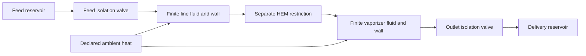

# Native stored-device dynamics and scheduled isolation

## Physical responsibility

`Lh2dtDynamicEquipment` composes actual native dynamic nodes, the checked equipment graph
and a caller-injected `DynamicNetworkSimulator` factory. The installed MIT LH2DT engine
owns fluid equations, wall exchange, HEM hydraulics and every RK integration step. The
host partitions prescribed command times, translates clocks, matches accepted solutions
and checks inventories. No alternate pipe, vaporizer, EOS or integrator is bundled.

The verified case resolves one mixed finite fluid volume and one wall temperature for
each of a transfer line and a vaporizer. Reservoirs provide its external boundaries. The
earlier finite phase-resolved tank/pump case is separate. FINITE_SUPPLY.md now combines
them into one numerically checked dynamic assembly; independent plant qualification remains open.



For each rigid device, the native balance uses signed incoming boundary streams:

```text
dM/dt = sum(mass_rate)
dU_fluid/dt = sum(mass_rate * upstream_enthalpy) + Q_wall_to_fluid
C_wall * dT_wall/dt = Q_ambient_to_wall - Q_wall_to_fluid
```

Thus stored total energy is fluid internal energy plus declared wall energy; boundary
transport is enthalpy. Internal fluid/wall exchange cancels in total energy. Negative
specific or stored energy can be valid under a declared reference. The current level
excludes port kinetic/potential storage, waves, slip and resolved temperature distributions.

## Python construction

The optional exact engine installation is in HANDOFF.md. Its imports remain separate from
the core wheel. Build native `DynamicHEMPipe` / `DynamicVaporizer` objects with your own
geometry, UAs, heat limits and property instance, then initialize their physical states.
Use native `dynamic_hem_pipe_node` / `dynamic_vaporizer_node` factories and attach their
named nodes as graph boundaries. Connect explicit native hydraulic components or the
shared-kernel valve, with the usual power readers and port IDs from NATIVE_EQUIPMENT.md.

```python
from lh2dt import DynamicNetworkSimulator, dynamic_hem_pipe_node, dynamic_vaporizer_node
from h2physics.adapters import Lh2dtDynamicEquipment, Lh2dtInventoryNode, lumped_inventory_reader
from h2physics.dynamics import ScheduledEquipmentCommand, InventoryTolerances

# network, line, heater, their initial states, and the two valves were constructed
# with the declared native property provider. Device names match graph boundaries.
bindings = {
    "line": Lh2dtInventoryNode(
        dynamic_hem_pipe_node("line", line, initial_line),
        lumped_inventory_reader(line.wall_heat_capacity, network.bridge.basis),
    ),
    "vaporizer": Lh2dtInventoryNode(
        dynamic_vaporizer_node("vaporizer", heater, initial_heater),
        lumped_inventory_reader(heater.wall_heat_capacity, network.bridge.basis),
    ),
}
driver = Lh2dtDynamicEquipment(
    network, bindings, simulator_factory=DynamicNetworkSimulator,
    tolerances=InventoryTolerances(mass_absolute_kg=1e-8, energy_absolute_j=1e-4, relative=1e-8),
)
result = driver.run(
    duration_s=1., time_step_s=.05, clock_id="declared-operation-zero",
    commands=(
        ScheduledEquipmentCommand("feed-isolation", .137, lambda t, graph: feed_valve.set_opening(0.)),
        ScheduledEquipmentCommand("outlet-isolation", .411, lambda t, graph: outlet_valve.set_opening(0.)),
    ),
)
accepted_state = result.steps[-1].native.states["line"]
final_balance = result.steps[-1].balances["line"]
actual_component = result.steps[-1].equipment.native_component_results["outlet-valve"]
```

`Lh2dtInventoryNode` accepts any compatible native node and your Python inventory reader.
The reader returns `ConservedInventory(basis, mass_kg, fluid_internal_energy_j,
solid_internal_energy_j)`. The helper above assumes a constant wall capacity and the
native pipe/vaporizer field names. A stratified tank needs its separate phase energies
and both wall capacities; it must also expose the corrected external heat contract from
`stratified_node_with_heat_ledger`. Do not substitute a bulk average or omit a wall.

Every derivative must explicitly expose finite `ambient_heat_W`, including an explicitly
adiabatic zero. A missing heat capability fails instead of silently becoming adiabatic.
Native state/component objects are retained for deep Python integration. Outer result
mappings are copied/read-only; native objects themselves are not deep immutable copies.

## Clocks and prescribed commands

`start_time_s` defaults to zero. All command times and returned accepted times use the
declared operation clock. Each native interval restarts its local clock at zero; the
adapter translates node derivative/ambient callbacks and `continuous_command` to absolute
operation time. The continuous callback runs at the initial point too. It must be smooth
inside each interval. Scheduled and continuous controls must not compete for the same
actuator. Commands receive the actual native graph and modify equipment modes; replacing a
dynamic boundary pressure/enthalpy is rejected because it bypasses conserved inventory.

Commands are grouped by exact time, with input order retained for simultaneous actions.
They execute once after the preceding interval reaches the boundary. The preceding final
RK stage uses the preceding mode; the next interval starts with the new mode. A transition
retains both hydraulic limits at the same physical time without advancing stored mass or
energy. `result.steps` contains one sample per accepted native step, with the left-limit
equipment state at a command endpoint. `result.transitions` contains `before` and `after`.
A command at run start/end is also explicit; `initial_equipment` is the pre-command state.
Do not linearly interpolate source flow across that jump or discard the right limit.

Duplicate command IDs, out-of-window commands and intervals below the reviewed native
1e-9 s clock floor fail. Accepted local and absolute times must increase and respect the
requested maximum step. A run starts from the bound native initial states. It mutates
graph/actuator modes; create/reset your case explicitly for a new independent experiment.
No actuator rollback is promised after a failed command or physical/solver failure.

The checked solve observer validates every stage and retains actual native solutions.
Accepted rows select their observer result by object identity. No fixed stage-call count
is inferred, and intermediate solves never enter accepted histories. Snapshots are buffered
for one command interval, so long histories still need memory proportional to that interval;
streaming callbacks are a remaining receiving-engine improvement in request 007.

Pressure-trigger localization, variable step rejection and mass/phase exhaustion events
are separate unfinished capabilities. A domain failure propagates; the driver does not
clip mass, replace the EOS or relabel it as a physical isolation event.

## Conservation and actual evidence

### Dynamic line cooldown audit

For a native run that cools a finite line, select an accepted-sample integral of gross
coolant mass entering the line and reconcile it with the native line's exact cumulative
transported-enthalpy and ambient-heat ledgers:

```python
from h2physics.adapters import (
    audit_dynamic_line_cooldown,
    compare_unidirectional_equipment_integrals,
    integrate_unidirectional_equipment_rate,
)

coarse = integrate_unidirectional_equipment_rate(
    coarse_run, inlet_mass_rate_reader, rate_unit="kg/s", integral_unit="kg",
    trajectory_id="cold-start-case-A",
)
coolant = integrate_unidirectional_equipment_rate(
    run, inlet_mass_rate_reader, rate_unit="kg/s", integral_unit="kg",
    trajectory_id="cold-start-case-A",
)
refinement = compare_unidirectional_equipment_integrals(
    coarse, coolant, normalized_tolerance=0.02,
)
refinement.require_current()
audit = audit_dynamic_line_cooldown(
    run, "line", coolant,
    coolant_enthalpy_rise_j_kg=declared_h_out_minus_h_in,
    coolant_only_energy_transport=True,
    evidence_ids=("coolant-flow-observation", "coolant-property-path"),
    coolant_mass_refinement=refinement,
)
audit.require_current()
```

The audit requires a closing native inventory balance, a common property basis, and an
identical operation clock/window for the gross-mass integral. The receipt retains exact
start/end times, native boundary mass/energy, both inventory closure residuals, the coolant
mass implied by native enthalpy transport, the accepted-sample mass difference, its
enthalpy residual, stored energy drop and ambient heat. The optional refinement receipt
reports signed/absolute/normalized mass changes and the interval-count ratio across two
matched trajectory IDs/clocks/windows, and verifies every coarse accepted time is present
in the fine accepted grid. It compares the normalized change to a caller-
selected tolerance and records the result; the pass flag is an engineering decision
criterion, not a truncation-error bound or proof of convergence.
The direction integral retains its originating `DynamicEquipmentRun`, ordered sampled
equipment snapshots and rate reader. The audit rejects an integral from another run, and
`require_current()` replays the reader against the original snapshot objects to detect
replaced samples or changed rates. Refinement and audit receipts propagate this check;
they also reject post-capture mutation of metadata or derived residuals before downstream use.
A positive
cooling duty is required. The direction-aware integral retains every signed sample and
rejects any sampled reverse-flow rate; between-sample reversal still requires time-step
refinement. The remaining Boolean declaration is a caller premise, not an inferred fact:
the selected line node must not carry another mass/energy stream over the audited window. Purge or
another energy-carrying stream requires a different decomposition and is outside this
projection. Native transported enthalpy is exact for the engine's accepted
run contract; gross coolant mass uses accepted samples and must be refined separately.
This receipt is an integration audit, not independent facility validation. Its deferred
synthetic contract is `native-dynamic-line-coolant-audit`.

`InventoryBalance` compares each device's actual stored change against the native
time-integrated signed mass and enthalpy/external-heat fluxes. Ledgers accumulate across
interval restarts. The transported-enthalpy plus external-heat split is also checked.
The relative scale uses changes/fluxes, so a large arbitrary reference energy cannot hide
a residual. Each node is checked before any global sum; opposite errors cannot cancel.
`InventoryClosureError.step` preserves a failed point for inspection. A custom reader
remains your declared physical interpretation and must include every modeled storage term.

```powershell
.venv\Scripts\python scripts/check_dynamic_inventory.py
```

The source checkout includes the complete synthetic case factory. The evidence record
`research/native_dynamic_inventory.md` gives exact inputs, native/source hashes and gates:

- 0.1 / 0.05 / 0.025 s runs agree. About 4.6627e-6 kg leaves after feed closure, before
  outlet closure. Each node closes near 1e-18 kg and 1e-13 J in this benign case.
- After both outside ports close, total mass stays fixed while internal transfer and
  ambient heating continue. A reversed sealed pair checks actual upstream enthalpy.
- A closed zero-fluid/wall-UA case has an analytic linear-ramp ambient wall solution,
  including an absolute clock 10–12 s and two interval restarts. Error is about 1.23e-7 K.
- Unsplit discontinuous RK controls bias final mass by about -6.95e-7 kg at 0.1 s despite
  closing their own flux ledgers. Correct command timing is a separate acceptance condition.
- Wrong wall storage and dynamic-boundary replacement are rejected. Portable unit tests
  also check absent heat, unknown accepted identities and inconsistent native ledgers.

These are synthetic numerical/interface limits, not independent pipe/boiling/valve data.
Source-specific UAs, frost, wave/spatial refinement, valve stroke/tightness, full phase
depletion and independent plant experiments remain research work. The combined assembly,
native mode selection and explicit sampled integrals are described in FINITE_SUPPLY.md.
