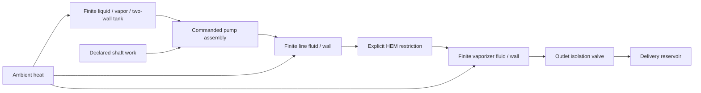

# Finite liquid-port supply assembly

## Reusable topology and ownership

`assemble_lh2dt_supply` connects an actual native stratified liquid-port tank to a
mapped pump assembly, finite mixed line, explicit restriction, finite mixed vaporizer
and outlet valve. It returns `Lh2dtSupplyAssembly` with the checked graph, dynamic driver,
commandable pump, original outlet, node identities and original native model objects.
The installed engine still owns phase/wall balances, equipment equations and integration.
The supplied restriction can use the common converged Darcy adapter described in
HYDRAULICS.md; the verification case explicitly selects it after a native transition failure.



This extends the separately checked finite-tank and stored-device cases into one
transient assembly. It retains one mixed volume per downstream device; it is not a
resolved cooldown front, wave/slip model or qualified plant digital twin. The example
uses authored synthetic geometry, maps and heat-transfer inputs. Exact parameters and
source fingerprints are in `research/native_finite_supply.md`.

## Direct Python construction and replacement

Construct each native model with your chosen parameters and initialize its native state.
All models must share the exact native provider instance used by `bridge`. Pass actual
objects, not configuration files or serialized approximations. `native_api` is the installed
native module or an explicit compatible factory namespace; `state_factory` is its state class.
No native implementation is imported automatically by the core package.

```python
from h2physics.adapters import assemble_lh2dt_supply
from h2physics.dynamics import ScheduledEquipmentCommand
from h2physics.equipment import BoundaryPower

assembly = assemble_lh2dt_supply(
    bridge,
    native_api=lh2dt, state_factory=NativeState,
    tank=tank, initial_tank=initial_tank,
    line=line, initial_line=initial_line,
    vaporizer=vaporizer, initial_vaporizer=initial_vaporizer,
    pump=mapped_pump, isolated_pump_component=closed_shared_valve,
    restriction=explicit_restriction, outlet=outlet_valve,
    delivery_state=delivery_state,
    tank_ambient_temperature_k=300.,
    power_readers={
        "running_pump": lambda native: BoundaryPower(shaft_work_w=native.shaft_power_W),
        "isolated_pump": lambda native: BoundaryPower(),
        "restriction": lambda native: BoundaryPower(),
        "outlet": lambda native: BoundaryPower(),
    },
)
result = assembly.driver.run(
    .15, .005, clock_id="declared-operation-zero",
    commands=(
        ScheduledEquipmentCommand("pump-and-feed-isolation", .037,
            lambda at, graph: assembly.pump.set_mode("isolated")),
        ScheduledEquipmentCommand("outlet-isolation", .073,
            lambda at, graph: assembly.outlet.set_opening(0.)),
    ),
)
native_tank_state = result.steps[-1].native.states[assembly.node_ids["tank"]]
original_pump_result = result.initial_equipment.native_component_results["pump-assembly"].native
```

Zero readers above are explicit adiabatic/unpowered declarations for this assembly,
not defaults inferred from missing result fields. Supply their actual heat/work if you
replace a branch with a powered or heated component. Required keys are checked. State,
geometry, initialization, pump map, restriction and vaporizer objects can be replaced
independently. The builder creates no additional line half-segments: the supplied
restriction is an explicit separate path, avoiding double-counted loss/volume.

The checked case supplies this explicit restriction before calling the builder:

```python
from fluids.friction import Churchill_1977
from lh2dt.pipe import PipeResult
from h2physics.adapters import Lh2dtDarcyPipe

explicit_restriction = Lh2dtDarcyPipe(
    native_hem_restriction, bridge,
    viscosity_reader=native_hem_restriction._effective_viscosity,
    friction_law=Churchill_1977, friction_law_id="fluids:Churchill_1977:Darcy",
    result_factory=PipeResult,
)
```

The private native viscosity hook is pinned; request 009 asks for a public equivalent.
The single common solver verifies final Darcy loss. The correlation choice changes the
empirical transition closure and is explicitly recorded. A native raw momentum zero is
insufficient at the retained failing transition point; no automatic replacement is made
when a caller supplies a different component.

Optional `node_ids` requires four distinct names for `tank`, `line`, `vaporizer`,
`delivery`; results retain those identities. The builder uses the native liquid phase
port and the explicit two-wall external-heat bridge. `stratified_inventory_reader` sums
both fluid-region masses/energies and both wall energies using declared constant capacities.
Use the lower-level graph/driver APIs for different topologies, ports or storage layouts.

## Mode semantics

`Lh2dtModeSwitch` maps names to `Lh2dtEquipmentMode(component, power_reader)` and selects
one branch through `set_mode`. `EquipmentModeEvaluation` retains the selected mode,
actual branch result and explicit `BoundaryPower`, forwarding native result fields.
Every branch uses the same native property instance. Missing power, an unknown mode,
incompatible provider or native model failure raises; no alternate branch is selected.

The example's `isolated` branch is an already closed shared-kernel valve. The change
represents ideal instantaneous combined stop/isolation of a zero-storage pump assembly.
It does not calculate rotor rundown, passive flow through a stopped machine, deadhead
heat, casing inventory or motor losses. In particular, stopping a pump and closing its
flow path are distinct physical actions. Native zero-rpm/machine-state extension
requirements are in request 008. Neither case inputs nor a failed solver establish an
actual protection response or event probability.

## Explicit sampled source and power integrals

```python
from h2physics.adapters import integrate_equipment_rate

def outlet_mass_rate(snapshot):
    return next(t.mass_flow_kg_s for t in snapshot.transfers if t.component_id == "outlet-valve")

delivered = integrate_equipment_rate(
    result, outlet_mass_rate, rate_unit="kg/s", integral_unit="kg",
)
print(delivered.value, delivered.basis, delivered.clock_id, delivered.method)
```

The helper integrates piecewise-linear accepted samples with trapezoids. Both before/
after command limits are included at the same time, so no triangle is interpolated
through an instantaneous closure. Signed rates remain signed; a different directional
quantity requires your explicit reader. Result metadata retain property basis, declared
rate/integral units, operation clock/window, interval count and quadrature method.
Unit strings are declarations, not automatic dimensional conversion or measured origin.

This is an explicit observation/integration rule, not native RK-stage quadrature or an
exact source integral. Refine samples and compare the chosen quantity before use. The
synthetic analytic jump unit test checks the discontinuity rule. The assembly check
compares independent sampled delivery/shaft/ambient integrals with actual inventory
changes; ambient power is recalculated from every wall temperature and its declared UA.
These sampled residuals and native per-node exact-flux residuals are separate evidence.

## Reproduce and interpret

```powershell
.venv\Scripts\python scripts/check_finite_supply.py
```

The exact optional engine setup is in HANDOFF.md. The script's complete case factory
reuses the previously recorded tank/phase state and pump map, then invokes the public
builder. Three time steps check mass/pressure and external-quadrature refinement. A
same-step original-property trajectory checks the single-flash facade separately.
The short sequence delivers about 3.0352e-5 kg, including about 1.5097e-5 kg after feed
isolation. After external closure the complete assembly retains mass and continues
heating; every stored node closes independently. Omitting pump work or using an invalid
head-map point fails, with the commanded mode retained.

Heating to 1 s reverses the internal restriction flow. A coarse 0.0025/0.00125 s pair
conserves inventory but fails the same 1e-6 final-state gate. The 0.00125/0.000625 s pair
passed that final-state gate, but exposed a separate finer-point native Darcy failure.
The corrected common-kernel/continuous-correlation case retains all gates. Accepted Darcy
loss is independently recomputed from actual
upstream density, signed mass flow and reported friction at a 0.01 Pa gate. The record
keeps this accuracy check separate from conservation and from the short-sequence comparison.

This is synthetic numerical/interface evidence. Broader heating envelopes, spatial/wave
refinement, trigger localization, phase/mass depletion, measured UAs/maps, rotor/actuator
dynamics, frost and independent facility experiments require additional work. The current
outlet is a declared reservoir/nozzle boundary; atmospheric and ground partitions remain
separate physics and must not be inferred from its liquid quality.
