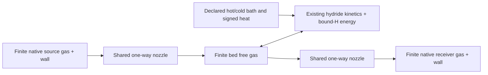

# Finite thermal hydride compression

`h2physics.storage.hydride_compressor.HydrideThermalCompressor` connects one finite
hydride bed to finite source and receiving hydrogen vessels. A specified cold
admission, isolated heating, hot delivery and isolated cooling sequence transfers
actual H2 into the receiver while its pressure exceeds the evolving source
pressure. Closed heating pressure rise is recorded separately and never counted
as delivered hydrogen.

This is an original lumped synthetic verification level. It does not establish
cyclic steady state, a qualified alloy, apparatus performance, vendor sizing or
measured efficiency. The final loading and all residual inventories are returned;
returning temperature alone does not close a material cycle. No MHC workbook
clock, pressure reference, normal-volume flow basis or bed observation has been
invented to calibrate the example.

## Physical owners and Python objects



The existing `FiniteHydrideBed.snapshot_from_inventory` and `rates` own the bed
state, uptake/desorption and thermal/binding reference. `HydrideKinetics`, its
equilibrium object and native thermodynamics remain replaceable objects. The
existing closed `FiniteHydrideBed.simulate` delegates to those same methods;
its API, output fields and closed acceptance tests are preserved.

The two actual native LH2DT `HomogeneousTank` objects own their gas/wall
derivatives. `HydrideGasThermodynamics.coolprop` owns the actual normal or para
HEOS objects. The existing `Lh2dtLowLevelProperties` facade exposes that very
same gas provider to the native tanks. The existing
`HomogeneousIsentropicNozzle.solve` owns every port flow/pressure/phase search.
One common SciPy DOP853 integration advances the three bodies and explicit
ledgers simultaneously; source, bed and receiver are not independently stepped
against stale reservoir states. There is no new gas EOS, hydride correlation,
native tank equation, choking equation or valve solver.

The actual native source remains separately installed at LH2DT revision
`b2f276333c1b1793c39f25763703d196d36742ec` under its MIT license. The existing
dependency receipt is [native_lh2dt.toml](../research/native_lh2dt.toml). The host
does not distribute its implementation. Optional imports occur only through an
explicit factory; native installation/path selection is caller setup.

The finite hydride and compressor model types are also available through the lazy
`h2physics.storage` facade, for example `from h2physics.storage import
FiniteHydrideBed, HydrideGasThermodynamics, HydrideThermalCompressor,
HydrideCompressorTrace`. These are the original class objects from their defining
modules; this package-level surface adds no state conversion or physical behavior.
The facade resolves only the requested exports, preserving light import for callers
that use only reservoir-driven hydride or other storage APIs.

```python
from h2physics.storage.hydride_compressor import (
    FiniteHydrideGasVessel, HydrideCompressorEvidence, HydrideCompressorNative,
    HydrideCompressorStage, HydrideThermalCompressor,
)

native = HydrideCompressorNative.from_installed(source_id=native_revision_id)
# bed is the existing FiniteHydrideBed with an explicit actual HEOS gas provider.
source = FiniteHydrideGasVessel.coolprop(
    native, bed.gas, vessel_id="source", native_geometry=source_native_geometry,
    pressure_pa=source_p_absolute, temperature_k=source_t,
    wall_temperature_k=source_wall_t, minimum_gas_mass_kg=source_floor,
    source_id=source_inventory_evidence,
)
receiver = FiniteHydrideGasVessel.coolprop(
    native, bed.gas, vessel_id="receiver", native_geometry=receiver_native_geometry,
    pressure_pa=receiver_p_absolute, temperature_k=receiver_t,
    wall_temperature_k=receiver_wall_t, minimum_gas_mass_kg=receiver_floor,
    source_id=receiver_inventory_evidence,
)
compressor = HydrideThermalCompressor(
    native, bed=bed, source=source, receiver=receiver,
    nozzle=shared_nozzle, inlet_opening=inlet, outlet_opening=outlet,
    evidence=source_clock_and_parameter_evidence,
)
trace = compressor.run(
    prescribed_stages, initial_solid=initial_loading_and_solid_temperature,
    initial_bed_gas=initial_native_gas_state,
    sample_interval_s=2., maximum_step_s=1., relative_tolerance=1e-8,
)
print(trace.admitted_hydrogen_kg, trace.delivered_hydrogen_kg)
print(trace.delivered_above_source_mass_kg, trace.termination)
```

Every stage is a `HydrideCompressorStage` with absolute start/end seconds,
independent inlet/outlet opening fractions, an existing finite-support
`FiniteHydrideHeatBoundary`, source/receiver bath temperatures and optional
signed direct wall powers. The stage heat callback receives absolute time and
the actual immutable bed snapshot. Clock IDs must agree and stages must join
exactly without gaps or overlaps. Simultaneously open inlet/outlet is rejected
by this sequential level. No bypass, pressure command, actuator lag or sensor
feedback policy is inferred.

Source and receiver require actual native `TankGeometry`/`TankState`/tank
objects. At this pinned revision both native UAs must be **strictly positive**.
Their real ambient/wall/fluid paths and wall capacities are retained. They are
never replaced by epsilon values to claim adiabatic vessels. Bath temperatures
are prescribed external utilities with integrated actual heat duty; they are
not finite utility-fluid or heat-recovery models. The bed's own declared
conductances may be zero for its existing physical limits.

## Reference and conservation

Write positive port flows as source→bed `q_in` and bed→receiver `q_out`, and
positive uptake as `m_dot_H = capacity*x_dot`. The shared bed rates distinguish
net external flow `q_in-q_out` from the total free-gas mass derivative
`q_in-q_out-m_dot_H`. External port enthalpy is
`q_in*h_source-q_out*h_bed`. Both use the upstream **stagnation** enthalpy;
nozzle exit kinetic energy dissipates in the receiving well-mixed control
volume. Substituting exit static enthalpy alone would lose energy.

The existing bed core resolves:

```text
dU_g/dt = H_external - m_dot_H*h_interface + Q_solid_to_gas + Q_external_gas
dU_s/dt = m_dot_H*h_interface - Q_solid_to_gas + Q_external_solid
U_s = C_s*(T_s-T_ref) + (capacity/M_H2)*x*e_bound
e_bound = h_gas_ref*M_H2 - DeltaH_des_ref
```

The interface enthalpy comes from the donor: actual free gas during absorption,
or a native gas state at the desorbing solid temperature during release. With
negligible bound-phase PV, reference closed absorption has
`DeltaU = P*v_molar - DeltaH_des`, approaching `R*T-DeltaH_des` for an ideal gas.
Nominal reaction heat remains an inspectable diagnostic and is never added
again to the total-U balance. Gas spin, molar mass, phase and enthalpy reference
must match across bed/nozzle/native vessels; normal↔para conversion is not
performed. Consistently shifting gas U/H and bound-H energy leaves physical
rates unchanged; shifting only one side is invalid.

Native tank fluid energy plus actual wall storage participates in each vessel's
ledger. Wall sensible-energy zero is the declared bed reference temperature;
constant shifts do not affect balances. All-body hydrogen includes source gas,
bed free gas, bound H2 and receiver gas. All-body U includes those three gas
energies, bed sensible/binding energy and both actual native walls. Internal
nozzle enthalpy, solid/gas material exchange and interphase heat cancel globally.
Only explicit bed heat and the two native external wall/bath powers remain.
Per-body mass/U, separate bed gas/solid energy, uptake, inlet/outlet mass and
enthalpy, interphase heat and native wall heat are separately inspectable.
Positive/negative bed thermal duties sum each signed heat channel without a
silent heat-recovery credit.

`FiniteHydrideBed.rates(..., isothermal_temperature_k=T)` is also available as
an explicit reference limit. Its gas thermostat uses the total mass derivative
times the native fixed-T inventory derivative, including external material
enthalpy. It does not ignore port mass or create an infinite H2 reservoir. The
compressor's normal run evolves gas and solid temperatures freely; the reference
mode is verified separately.

## Events, snapshots and limits

Each segment retains the original common `OdeResult`, actual native tank
states/derivatives, the actual bed and HEOS objects and both `NozzleResult`s.
The sequence uses exact command-time partitions. Adjacent segments deliberately
retain two endpoint observations at the same clock, with different pre/post
commands and continuous physical inventories. These duplicate boundary clocks
are not a single strictly increasing `TimeSeries`.

The shared nozzle supplies one-way zero flow at reverse/equal pressure. Positive
free-gas inventory floors for bed/source/receiver are terminal root events;
the actual root time/state is returned and remaining requested stages are not
run. No mass, loading, signed heat or flow is clipped. Existing loading factors
approach0/1; invalid numerical trials, native phase/property failures and domain
exits raise instead of selecting another EOS or inventing a limiting rate.
A domain failure may precede a mass-floor root. Positive trial states across a
floor remain evaluable so a physical bracket can be located.

`HydrideCompressorTrace` is now admitted only with a one-use token issued after
the coupled native integration completes. Construction checks the original model
evidence, initial schedule clock, typed segment lineage, contiguous stage clocks
and event endpoint. A copied trace cannot establish a fresh issuance baseline.
`require_current()` fingerprints the retained snapshots, accepted native solution
arrays, nozzle/bed audit points, ledgers and stage records; summary properties call
this check before returning. Changing an accepted array invalidates the captured
trace even when its immutable summary fields were left untouched.
The `hydride-compressor` deferred Nurion profile records this contract together
with synthetic all-body mass/energy budgets and a native-array mutation rejection.
It has not been run.

`delivered_above_source_mass_kg` partitions integrated outlet mass at localized
roots of receiver pressure minus evolving source pressure. This uses bracketed
first crossings in the common solver and needs step refinement. It does not
prove detection of arbitrary hidden nonmonotonic crossings within one solver
step. The authored verification has a persistent receiver/source pressure gap;
all delivered gas is demonstrably delivered against higher pressure. A simple
pressure ratio, peak closed pressure or selected equilibrium plateau is not
promoted to delivered mass or an efficiency.

`HydrideCompressorIntegrationError` retains completed segments, the current
original returned solution when available, its audited prefix, actual last
trial time/vector and separate failing post-run audit time/vector. An exception
inside the integrator may prevent SciPy returning a partial `OdeResult`; no
accepted failed-stage history is fabricated. The original native/callback cause
is retained. Actual native objects remain mutable; external mutation during a
run invalidates their correspondence with recorded immutable snapshots.

Resolved physics is limited to one uniform-pressure bed with one solid and one
gas temperature, constant free volume/capacity/sensible heat capacity, the
chosen existing equilibrium/kinetics and two homogeneous native vessels. No
porous transport, temperature gradients, evolving powder/porosity, bed wall
resolution, multibed continuous operation or cyclic steady state is solved.
No finite HTF circuit, heater/refrigerator performance, recovery, exergy or
manufacturer efficiency is inferred from the integrated signed bath duties.

## Verification and primary basis

The check script authors its own synthetic geometry, heat/kinetic parameters,
inventories, openings and clocks. It performs actual finite compression,
independent native PT mass/U reconstruction, time refinement, positive floors,
reverse/zero and isolated-heating limits and independent ideal/reference tests.
All prior16 closed finite-bed tests must still pass. Exact measured numerical
results, native/host hashes and local timing are recorded in
[hydride_compressor.md](../research/hydride_compressor.md).

```powershell
.venv\Scripts\python -m pytest tests/test_hydride_compressor.py tests/test_finite_hydride.py -q
.venv\Scripts\python scripts/check_hydride_compressor.py --native-target artifacts/native_packages
```

Scientific context is the primary
[Brown et al.2006 finite hydride mass/energy paper](https://escholarship.org/uc/item/67p6w2p3),
[Krane et al.2021 coupled reactor paper](https://arxiv.org/abs/2107.06095), and
[Fleming et al. thermal compressor concept](https://pmc.ncbi.nlm.nih.gov/articles/PMC12988172/).
Gas properties remain the actual
[Leachman hydrogen EOS](https://doi.org/10.1063/1.3160306) through
[CoolProp native APIs](https://coolprop.org/coolprop/LowLevelAPI.html).
No paper prose, coefficient tables, source implementation or worked example is
copied. MHC measured-data reference/clock/calibration gaps remain open; the
synthetic numerical evidence is not an apparatus comparison. Parent request020
records the next receiving contracts.
