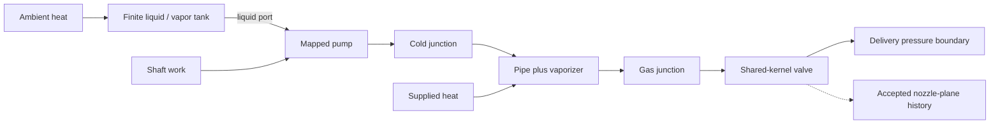

# Native equipment, property reuse and conserved supply networks

## Responsibility and model level

The installed MIT LH2DT engine owns pipe friction, homogeneous-mixture pipe closure,
pump performance maps, vaporizer heat exchange, phase-resolved tank equations, junction
solution and RK4 integration. This library supplies common Python state/power/port contracts,
optional property and valve adapters and independent conservation checks. No native solver
source or manufacturer parameter curve is bundled. The checked revision is
`b2f276333c1b1793c39f25763703d196d36742ec` (lh2dt_models 0.1.2).

Those original checks use native pipe friction. The later supply stress test exposes a
native transition inconsistency; its corrected restriction uses the original common
Darcy root plus an explicit fluids correlation, retaining native HEM viscosity and all
inventory equations. HYDRAULICS.md documents that numerical/closure decision and request 009.

The first coupled case has finite liquid/vapor/wall tank inventories and quasi-steady
equipment between the tank and a pressure boundary. It does not yet resolve line inventory,
water hammer, dynamic vaporizer inventory, complete isolation or arbitrary plant topologies.
The two-phase tank regions are liquid and vapor; they are not a spatial gas-temperature
stratification model for the warm DisCha experiments.

A separate continuation now resolves finite mixed line/vaporizer fluid and wall inventories
with scheduled two-sided closure. See DYNAMIC_INVENTORY.md. This does not retroactively add
those storage terms to the original two-second tank/pump evidence case.



## State, power and port API

`equipment.BoundaryPower(heat_w, shaft_work_w)` is positive into the modeled fluid.
`ConnectionTransfer` retains component/node/port identities, signed left-to-right mass
flow, actual upstream state, downstream transmitted state and independently declared power.
Negative flow reverses upstream/downstream ownership. A closed connection has no transported
state. These are steady enthalpy-only ledgers: `abs(mdot)*(h_out-h_in) = heat + shaft_work`.
Finite port kinetic/potential energy is outside this declared level. No vector momentum
closure is inferred from an energy balance.

`Lh2dtEquipmentNetwork(native_network, bridge, state_factory=...)` calls the native graph.
Its node/state and result mappings are copied/read-only; actual native solution/component
objects remain available for deep integration. Inputs are Python objects and factories.
The graph/property bridge must share a native provider instance. A component without that
instance needs an explicit compatible declared basis; an already contradictory native fluid
identity is rejected even if a caller supplies a matching label.

```python
from pathlib import Path
import sys

# For the isolated optional installation used by HANDOFF.md:
sys.path.insert(0, str(Path("artifacts/native_packages").resolve()))
from lh2dt import SteadyNetwork
from lh2dt.properties import ThermoState as NativeState
from h2physics.adapters.lh2dt import Lh2dtProperties
from h2physics.adapters.lh2dt_properties import Lh2dtLowLevelProperties
from h2physics.adapters.lh2dt_equipment import Lh2dtEquipmentNetwork
from h2physics.thermo import CoolPropProperties

eos = CoolPropProperties("ParaHydrogen", quality_roundoff_tolerance=1e-8)
native_properties = Lh2dtLowLevelProperties(eos, state_factory=NativeState)
bridge = Lh2dtProperties(native_properties, reference_id=eos.basis.reference_id)
network = Lh2dtEquipmentNetwork(
    SteadyNetwork(native_properties), bridge, state_factory=NativeState,
)
network.add_boundary("supply", bridge.state_pt(300_000., 20.))
network.add_boundary("delivery", bridge.state_pt(150_000., 300.))
```

Add actual native components with explicit `power_reader`, source and target ports.
A mapped pump reader uses its `shaft_power_W`; the checked vaporizer link uses
`thermal_power_W` with an adiabatic, unpowered hydraulic subcomponent. Do not omit a
hydraulic heat/work contribution merely because a thermal wrapper also reports heat.
Conservation checks reject a mismatched power reader. The complete runnable topology and
all authored parameters are in `scripts/check_equipment_network.py:make_case`.

`network.solve()` returns `EquipmentNetworkSnapshot`. It recomputes transport and junction
ledgers and checks `EquipmentTolerances` for boundary/junction mass, component/junction and
boundary enthalpy/power, reported momentum and declared operability. `native_success` alone
does not establish operability. A deliberately insufficient NPSH requirement is rejected
despite a mathematically converged mass/energy point. Missing momentum remains `None` and
appears in `missing_momentum_components`. NPSH has not been assessed when the native
requirement/margin is absent, regardless of a permissive native predicate.

On rejection, `EquipmentClosureError.snapshot` preserves diagnostics. Exploratory calls
can use `require_closed=False` and inspect `snapshot.violations(tolerances)`. The snapshot's
`native_component_results` contains actual native results, including pump map/NPSH fields.
Boundary reservoir temperature is distinct from `transfer.transmitted.temperature_k`;
the former must not replace the delivered stream's temperature.

## One valve kernel

`Lh2dtSharedValve` implements the native two-port protocol by calling the existing
`HomogeneousIsentropicNozzle`. Opening fraction, effective area and reverse permission
are explicit. The result contains the actual native factory result under `.native` and
the complete solved source under `.nozzle`. The native ABI retains a numeric placeholder
throat pressure when closed; only `.nozzle.regime`/`.nozzle.exit_state` describe whether a
physical nozzle-plane state exists. A closed source has no such state.

The solved nozzle has static enthalpy plus kinetic energy equal to upstream stagnation
enthalpy. A remote throttling/mixed downstream port carries upstream enthalpy at the lower
pressure; it is not the isentropic throat state. `.nozzle` preserves that distinction,
search/quality diagnostics and the correct handoff for a future jet model. No outlet liquid
fraction is assigned to the ground. Valve actuator/stroke/manufacturer behavior is outside
this steady opening-area level.

## Property acceleration without another EOS

`Lh2dtLowLevelProperties` exposes the tested native subset through a single protected HEOS
AbstractState and the actual native state factory. It supports PT, PH, PS, PU, P-rho,
rho-U, saturated liquid/vapor, saturation pressure and phase viscosity. The host provider
adds the corresponding inverse-state methods and `saturated_at_temperature`.

This facade explicitly requires HEOS. It does not extrapolate a cryogenic table, silently
fall back or claim support for all native methods/type-checking constructors. Unsupported
methods remain absent. Use the native reference implementation or extend/verify the
capability contract before selecting a component that needs another method. Do not change
a global energy reference or fluid/spin identity during a run.

The checked native implementation permits tiny quality endpoint roundoff. The faster
case explicitly selects the same 1e-8 budget. The native state class has no raw-quality
field; the facade retains `maximum_quality_adjustment`, `quality_adjustment_count` and
`last_adjusted_state` with the raw value. Strict zero remains available on the host provider.
Intermediate two-phase viscosity is not supplied by the property facade; the native HEM
pipe retains its own declared phase-weighted closure.

`scripts/check_lh2dt_property_provider.py` compares 60 state-interface queries plus viscosity
and saturation pressure. In the recorded run, complete native-state construction is about
22.7 times faster; the complete coupled solver is about 2.34 times faster at the compared
time step. These are different workloads and measured results, not a general speed guarantee.
See `research/native_property_provider.md` and `native_equipment_network.md`.

## Dynamic phase port and external heat

The native `stratified_tank_node(..., boundary_phase="liquid")` already supports an explicit
phase port. It is distinct from the previously checked homogeneous bulk-outflow model.
`stratified_node_with_heat_ledger(native_node)` retains its derivative/advance/combine
callbacks while exposing the sum of the two external ambient-wall heat terms to the
generic simulator. It does not change phase equations. The reviewed native generic ledger
otherwise omits these terms; request 007 supplies the reproducible receiving change.

```python
from lh2dt import DynamicNetworkSimulator
from h2physics.adapters.lh2dt_equipment import stratified_node_with_heat_ledger

# native_node was built for the already-declared "supply" boundary.
node = stratified_node_with_heat_ledger(native_node)
trace = DynamicNetworkSimulator(
    network.checked_native(), {"supply": node},
).simulate(duration_s=2., time_step_s=0.25)
```

The checked structural graph view validates every native solve, including RK stages.
`on_solve` is an optional diagnostic callback; its samples have no implicit accepted clock.
The evidence script uses the exact reviewed five-solves-per-step contract to integrate an
external ledger with RK4 weights and construct SourceHistory only from accepted endpoints.
That grouping is version-specific and asserted. Request 007 asks for an explicit accepted
callback/metadata contract. Switching/isolation still requires properly defined event windows
and resolved storage; a steady closed valve does not prove residual-line release physics.

## Evidence and remaining work

The synthetic case delivers about 0.00309043 kg in 2 s. Reported external mass/energy
residuals are around 1e-12 kg / 3.4e-6 J. Three time steps agree within the declared
mass/pressure gates; no convergence order is inferred from noisy/nonlinear solver floors.
Laminar gas/HEM limits match an independent Poiseuille calculation; native vaporizer
enthalpy quadrature is compared to a DOP853 enthalpy-coordinate reference on the same EOS.
These are numerical/interface checks, not independent equipment experiments.

Run both scripts after installing the exact optional engine as documented in HANDOFF.md.
Remaining work includes independent source-specific equipment data, validated pump/UA maps,
trigger localization and depletion,
broader topology/state envelopes, uncertainty and external jet/impact/dispersion coupling.
The separate finite-device driver now matches accepted solutions by identity and resolves
prescribed closure windows without relying on the five-call profile of the earlier script.
FINITE_SUPPLY.md now documents the combined finite phase-resolved tank, pump assembly,
stored line and stored vaporizer, including explicit modes and longer heating/reverse transfer.
