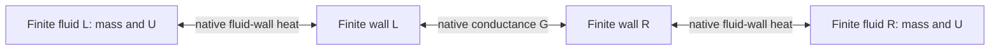

# Two finite native fluid/wall sides

The 2026-10-28 provenance/result-boundary increment is **implemented_unverified**.
Only static source/API, AST, Ruff and LF checks were performed. Historical native
calculations below retain their original source hashes; current bytes and the
four new `heat-exchanger-boundaries` cases await deferred execution.

## Public finite-side and trace binding

The original simultaneous native integration remains in use. `native_provenance`
retains exact installed LH2DT source/revision and original native method bindings;
returned traces additionally retain the actual created native side nodes,
composite node, network and simulator provenance. A caller-authored network
factory is a bound callback rather than attested native physics; its produced
objects must still be original native classes and satisfy the closed topology.
The separate property facades remain explicit; source attestation does not
qualify an arbitrary EOS callback. Recognized tabular backends are rejected
without a separate domain/error qualification contract.

`trace.finite_sides` retains each original finite source specification and its
native initial mass/U/wall state. Configuration guards bind source IDs, phase/
temperature/pressure/inventory domains, property/energy/spin bases, native fluid
volume, wall C, UAs, native heat cap, factories and methods. The fixed source
inventories are not replaced with streams. Native EOS recovery must reproduce
each conserved fluid mass and U within the unchanged inventory tolerance.
Each side keeps its own reference; no material or enthalpy reference conversion
occurs across the wall. All reported pressures are `Pa_absolute`.

`trace.require_current()` rejects changed accepted-row dictionaries, native side
states/derivatives, summary/clock/ledger values, network topology, simulator node
bindings and mutated configurations. Only an owner-issued original trace may
pass; cloning cached summaries is insufficient. The owner's registry is weak,
so it does not retain every trace. Guards preserve research correspondence,
not security against deliberate private-field modification.

The explicit `trace.clock_tolerance_s` records the absolute projection budget.
Requested duration, first step, each native local stage and accepted row must
advance/reproduce elapsed time within that budget; no epoch reset is performed.
One owner cannot integrate concurrently against its mutable native properties.

`HeatExchangerIntegrationError` now retains original `cause`, simulator/network,
side nodes/components/source evidence, the last available native trial, returned
raw `native_rows` and prior audited `completed_points`. Setup and post-run audit
failures use the same retained-context contract. If native `simulate` itself
raises before returning rows, the public native API does not expose a completed
row history: only available initial prefix and last trial can be retained.
No accepted history or heat is fabricated to fill that native capability gap.

`examples/lh2dt_heat_exchanger.py` defines the original synthetic normal/para
two-fluid case. Five deferred cases cover conservation/provenance, native-row/
method/copy rejection, post-run closed-topology failure retention, zero-UA/clock/
refinement limits and extraction of the native per-side transfer history. Neither
examples nor case discovery was run locally.

`h2physics.adapters.lh2dt_heat_exchanger.Lh2dtFiniteHeatExchanger` couples two
actual native LH2DT `DynamicVaporizer` cores. Both fluid inventories and both
walls respond to their current counterpart. Each side retains finite mass,
fluid internal energy, wall heat capacity and its own property/energy basis.
There is no prescribed cooling outlet or infinite heat bath.

This is a closed, spatially uniform thermal level: no material ports, external
heat leakage, hydraulic pressure-drop model or counterflow/parallel-flow profile
is present. Its declared wall conductance is an input with source/origin evidence,
not a vendor rating or an inferred UA. The distinction from existing prescribed
cooling is the second finite responding fluid/wall inventory.



## Native physical and numerical ownership

The separately installed MIT LH2DT snapshot
`b2f276333c1b1793c39f25763703d196d36742ec` owns every physical side derivative,
EOS recovery, fluid-wall heat cap, state advance and RK derivative combination.
One actual native `DynamicNetworkSimulator` advances a public composite
`DynamicNodeModel` containing both actual native fluid/wall states simultaneously.
No separate staggered side solves or host ODE solver are used.

The native `DynamicVaporizer.derivative_from_flows` exposes an
`ambient_temperature_K` argument. Here it is explicitly connected to the other
**current finite wall temperature** at every common stage. Both native
`ambient_UA` slots must equal the declared wall-to-wall conductance `G`. Native
heat evaluation therefore supplies

```text
Q_into_L = G * (T_wall_R - T_wall_L)
Q_into_R = G * (T_wall_L - T_wall_R)
Q_into_L + Q_into_R = 0
```

Those expressions describe the delegated native conductance law; there is no
second heat-law implementation in the adapter. Each native derivative also
retains its own fluid-wall conductance and symmetric `maximum_heat_W` cap. The
interwall path and the fluid-wall films are distinct physical resistances.

The native field name `heat_from_ambient_W` means heat received from the other
finite wall in this composition. It is not outside-system heat. The native
constructor's nominal ambient temperature is overridden at every evaluation;
its fixed value never becomes a bath. Native configuration changes, unequal
conductances and nonconservative derivatives fail rather than silently adjusting
a side to make the total close.

For each side, native physics supplies constant fluid mass and

```text
dU_fluid/dt + C_wall * dT_wall/dt = Q_from_other_wall
E_side = U_fluid + C_wall*T_wall
Delta E_L + Delta E_R = 0
```

Only signed per-side accumulated heat is appended by the adapter. Composite
state advances call the original native node `advance`, and composite derivative
combination calls the original native node `combine_derivatives`. The same
native RK stages integrate these heat ledgers and physical states.

`HeatExchangerTrace.wall_transfer_series(side_id)` exposes one selected side's
native accepted clock, instantaneous interwall heat-rate samples and the cumulative
heat already integrated by the native composite RK stages. Positive values mean
heat entering that side. This is an exact read-through of the retained trace: it
does not interpolate between accepted times, reintegrate sampled rates or create
an alternative energy balance. The returned `HeatExchangerWallTransferSeries`
revalidates against its original trace before returning the arrays.

The generic native simulator requires a thermodynamic boundary even for a
closed composite thermal group. A private, port-free native network carries the
left-side thermodynamic state solely to satisfy that API. It is **not an
aggregate exchanger pressure, enthalpy or material state**. Physical outputs are
always separate side snapshots. Any added material port, link, hydraulic
junction or extra network boundary is rejected. This restriction also permits
distinct fluid/energy bases without a shared material-reference conversion.

## Python construction

The following values are original synthetic verification parameters. Import the
reviewed native package separately as described in HANDOFF.md; no native engine
or external mechanism is bundled by this adapter.

```python
from lh2dt.dynamic_network import DynamicNetworkSimulator, dynamic_vaporizer_node
from lh2dt.dynamic_vaporizer import DynamicVaporizer
from lh2dt.network import SteadyNetwork
from lh2dt.properties import ThermoState as NativeState

from h2physics.adapters.lh2dt import Lh2dtProperties
from h2physics.adapters.lh2dt_properties import Lh2dtLowLevelProperties
from h2physics.adapters.lh2dt_heat_exchanger import (
    FiniteHeatExchangerSide, HeatExchangerCoupling, HeatExchangerDomain,
    Lh2dtFiniteHeatExchanger,
)
from h2physics.core import Origin
from h2physics.thermo import CoolPropProperties

G = 2.  # W/K, explicitly authored interwall conductance

def side(name, fluid, temperature, pressure, volume, wall_capacity, film_UA):
    properties = CoolPropProperties(fluid)
    native_properties = Lh2dtLowLevelProperties(properties, state_factory=NativeState)
    bridge = Lh2dtProperties(native_properties, reference_id=properties.basis.reference_id)
    core = DynamicVaporizer(
        fluid_volume_m3=volume, wall_heat_capacity_J_K=wall_capacity,
        fluid_wall_UA_W_K=film_UA, ambient_temperature_K=300.,
        ambient_UA_W_K=G, maximum_heat_W=1e6, properties=native_properties,
    )
    initial = core.initialize(native_properties.from_pT(pressure, temperature))
    return FiniteHeatExchangerSide(
        name, core, initial, bridge,
        HeatExchangerDomain(200., 650., 1e3, 1e7, 1e-8,
                            ("gas", "supercritical_gas", "supercritical")),
        "authored-finite-inventory-verification",
    )

left = side("left", "Hydrogen", 400., 3e5, .01, 100., 5.)
right = side("right", "ParaHydrogen", 250., 2e5, .02, 150., 6.)
exchanger = Lh2dtFiniteHeatExchanger(
    left, right,
    HeatExchangerCoupling(G, "authored-interwall-conductance", Origin.SYNTHETIC,
                         "LH2DT:b2f276333c1b1793c39f25763703d196d36742ec"),
    native_side_node_factory=dynamic_vaporizer_node,
    native_network_factory=SteadyNetwork,
    native_simulator_factory=DynamicNetworkSimulator,
    equipment_id="authored-two-fluid-HX",
)
trace = exchanger.run(duration_s=20., maximum_step_s=.125,
                      start_time_s=100., clock_id="authored-operation-clock")
last = trace.points[-1]
print(last.sides["left"].fluid.temperature_k,
      last.sides["right"].fluid.temperature_k,
      last.global_energy_residual_j)
```

The example ends near fluid/wall temperatures 366.645/360.755 K on the left and
268.070/275.165 K on the right. Each side's pressure follows its native finite
inventory EOS; there is no imposed outlet pressure or solved exchanger pressure
drop. Masses remain independent and fixed.

Each side requires an actual native component, actual initial state, matching
native property instance, explicit side/source identity and declared fluid/wall
temperature, absolute-pressure, inventory and phase bounds. Public native
property bases, where available, must match the bridge declaration. Normal and
para identity is retained separately in the example; no spin conversion or
enthalpy-reference transformation is inferred. The two bases do not need to be
equal because no mass moves between them. Energy changes are checked separately
before their closed-system sum, so arbitrary constant reference offsets cannot
create heat transfer.

## Results, clocks and failures

`trace.points` contains the initial point and each accepted native step.
`point.sides[side_id]` retains actual native state and derivative objects, a
separate physical `ThermoState`, a `ConservedInventory` and the existing
`InventoryBalance`. A side's balance heat is the energy crossing its boundary
from its counterpart; the complete pair has zero external boundary heat.
`point.global_energy_residual_j` and `integrated_coupling_residual_j` check both
the whole physical storage change and cancellation of signed heat integrals.

The default side budgets are 1e-12 kg, 1e-5 J and relative 1e-10; native heat-rate
closure is checked at 1e-9 W. Per-side failures are checked before a global sum,
so opposite inventory errors cannot hide each other. These are explicit numerical
acceptance parameters, not claims of measured material accuracy.

Actual components, native side/composite nodes, the single native simulator,
private scheduling network and actual native step results remain available.
Accepted results match their derivative evaluations by composite-state object
identity, with no inferred fixed stage-call count. Trial evaluations are buffered
for the integration window and then reduced to accepted points; a streaming
accepted-step hook would reduce memory for long runs. Native objects remain
mutable, so modifying them invalidates their correspondence to a recorded trace.

An explicit absolute operation clock maps each native local stage time. Requested
start/end, actual evaluated clock bounds and pair-derivative evaluation count are
recorded. Native intervals must be at least 1e-9 s; `clock_tolerance_s` explicitly
bounds native time roundoff and defaults to 1e-10 s. No measured clock is inferred,
clamped or aligned. This closed level has fixed parameters and no boundary
histories to extrapolate.

Native EOS/phase failures, bounds violations, nonpositive inventory, unknown
native capabilities and per-side/global closure failures propagate. A failed
integration retains the actual native simulator, components and last actual
trial at `HeatExchangerIntegrationError`; no fluid mass, heat or wall state is
clipped. Coarse explicit RK steps can leave the declared thermal domain, so
time refinement remains an application requirement.

## Independent limits and current scope

The tests and replay check actual native objects against independently derived
limits:

- With both fluid-wall conductances zero, fluid energies stay constant and the
  two finite walls obey an analytic exponential. Their weighted mean stays
  fixed and `T_wall_L-T_wall_R` decays with rate `G*(1/C_L+1/C_R)`.
- Zero interwall conductance and uniform temperature are independent stationary
  limits. Finite initially opposing wall/fluid storage can reverse heat direction
  without external work or an infinite bath.
- A fresh native fixed-density energy root includes both fluid inventories and
  both walls. The long-time four-temperature equilibrium agrees with it.
- A fresh native PT provider reconstructs each side's mass and energy from its
  reported pressure/temperature. Accepted-sample heat quadrature is checked
  separately from the native integrated ledger.
- Three native maximum steps compare all four ending temperatures. Native
  fluid-wall heat caps, phase/reference guards, parameter mutation, wrong
  derivatives and unqualified process-network boundaries have negative tests.

```powershell
.venv\Scripts\python -m pytest tests/test_lh2dt_heat_exchanger.py -q
.venv\Scripts\python scripts/check_heat_exchanger_integration.py
```

Detailed versions, fixed gates, actual local timing and begin/end native/host/
test/replay hashes are in
[research/native_heat_exchanger.md](../research/native_heat_exchanger.md).
The verification inputs do not qualify an alloy, vendor UA/map, flow distribution,
counterflow effectiveness, LMTD/NTU relation or pressure-loss correlation.

Process ports, flow/thermal isolation commands, heat leakage, variable conductance,
phase-change equipment qualification and spatial models remain future work.
They require explicit native heat/material ports and conservative per-side
boundaries before being connected here. Useful receiving APIs include a native
thermal-group node without a representative hydraulic state, separate wall heat
ports with independent external/internal ledgers, and accepted-step streaming.
No receiving repository or shared catalogue is edited by this adapter work.

Primary sources: [native LH2DT](https://github.com/lyullee/lh2dt_models),
[native finite-fluid/wall balance](https://github.com/lyullee/lh2dt_models/blob/b2f276333c1b1793c39f25763703d196d36742ec/src/lh2dt/dynamic_vaporizer.py),
and [CoolProp native EOS library](https://doi.org/10.1021/ie4033999).
The composition, analytic cases, tests and explanations are original; native
physical equations, heat laws, source code, external tables and figures are not
copied into the distribution.

## Transient flowing hold-up — implementation only

`adapters.lh2dt_transient_flowing_exchanger.Lh2dtTransientFlowingExchanger` adds
simultaneous finite two-fluid/wall operation with explicit signed native side-flow
callbacks at each native integration stage. DynamicVaporizer.derivative_from_flows
owns fluid/wall equations and upwind outlet enthalpy; DynamicNetworkSimulator owns
integration. The existing finite exchanger's side-domain and configuration gates
remain mandatory. Augmented side ledgers retain transported mass, stream enthalpy
and interwall heat, with independent accepted mass/energy and opposite-heat checks.
The callback evidence must identify the native stream energy reference; native
MassEnergyFlow objects do not carry a common PropertyBasis. Pressure loss is supplied
by the caller's boundary models. Native evaluations, rows, simulator and original
failures are retained. This model level has not been executed scientifically.

`TransientExchangerInterwallHeatAdapter` exposes accepted internal heat increments
through the existing HeatDuty API with internal-transfer scope. This does not create
external utility demand or recoverable-heat credit. Endpoint wall temperatures are
observations, not a qualification of passive heat availability. Existing physical
and primary-source references above apply to the reused native equations.

For declared boundary jumps, `run(interval_boundary_streams=...,
boundary_change_times_s=...)` restarts the same native simulator class at each
explicit interval, carrying the exact final physical state and augmented ledgers
into the next initial state. The interval callback receives exact physical time
and interval bounds so the caller declares the appropriate endpoint command.
`native_segments` retains each simulator and its original relative rows. The
continuous callback route rejects declared jumps; grid alignment alone cannot
preserve both RK endpoint limits. Declared jumps require the interval callback;
unknown event roots and unresolved jump-limit conventions are not inferred.

The transient flowing trace is issued only by the native run method. Direct
construction and `dataclasses.replace()` cloning are rejected, so a caller cannot
relabel a copied set of native rows, stream evaluations or cumulative mass/heat
ledgers as a new accepted operation.

`CoolPropMixtureProperties.phase_partition_pq()` now obtains native VLE phase
compositions and exposes separate mass/mole quality plus finite phase component
amounts. See API.md. These new states and segmented heat runs remain unexecuted.
