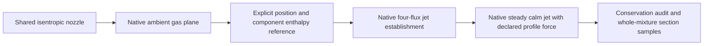

# Native gas expansion and calm jets

The shared nozzle now connects to actual DEGALI gas-plane and steady axisymmetric-jet
objects. The native engine owns the expansion closure, profiles, entrainment, phase
enthalpies and spatial integration. The host checks identity, reference, geometry and
conservation, retaining the native objects for direct Python composition. This is a
partial gas-release/dispersion level. It does not complete liquid partition, ground
impact, transient transport, crosswind or an experimental measurement operator.



## Install and reproduce

Use the exact separately installed MIT native snapshot recorded in
`requirements/native-degali-pinned.txt`. It declares package version 0.3.0; the checked
PyPI release 0.1.0 is not an interchangeable provider. No native implementation, reference
Fortran, experimental data or source-derived figures are bundled with h2physics.

```powershell
.venv\Scripts\python -m pip install -e ".[thermo,test]"
.venv\Scripts\python -m pip install -r requirements/native-degali-pinned.txt
.venv\Scripts\python scripts/check_degali_integration.py --plot
```

An already-installed isolated native package directory can instead be selected with
`--native-packages artifacts/native_dispersion_packages`. That directory must contain
the exact reviewed package; the check verifies a path/byte fingerprint. DEGALI's broad
package imports also require PyAMG, even for this integral-jet path. The observed
environment has PyAMG 5.3.0. The core `h2physics.adapters.degali` import needs neither
DEGALI, PyAMG nor CoolProp. The two latter packages are runtime prerequisites only when
the selected native path is executed.

Read `research/native_degali.md` for actual positive and failed gates, numerical settings,
runtime and hashes. A failing research gate exits nonzero after preserving the report;
do not infer that an available output is an accepted prediction.

The current two-fluid research command intentionally exits nonzero: the normal-H2
321-point case passes, but the para-H2 641-point case has about 0.346 W maximum energy
error against an unchanged 0.238 W budget. Endpoint Y/T agreement and species/momentum
conservation do not override that failure. The normal-H2 example below passes; replacing
it with the recorded cold input requires inspecting the failure, not raising the limits.

## Compose actual Python objects

```python
from degali.addons.axisymmetric_jet import (
    AxisymmetricJetSource, SourceEnthalpyBoundary, ConservedGaussianJet,
    phase_ambient_from_rh,
)
from degali.addons.hydrogen_eos import hydrogen_gas_departure
from degali.addons.notional import expand_measured_throat_to_ambient
from h2physics.adapters.degali import (
    SHARED_AREA, JetPlane, expand_nozzle_gas, axisymmetric_boundary,
    profile_integrated_buoyancy_type, run_axisymmetric_jet,
)
from h2physics.release import (
    HomogeneousIsentropicNozzle, NozzleOpening, SourceLocation,
)
from h2physics.thermo import CoolPropProperties

properties = CoolPropProperties("Hydrogen")
nozzle = HomogeneousIsentropicNozzle(properties).solve(
    properties.state_pt(2e6, 300.), back_pressure_pa=101325.,
    opening=NozzleOpening.circular("opening", .002, effective_area_factor=.8,
        area_basis_id="declared-effective-stream-and-pressure-area"),
)
plane = expand_nozzle_gas(nozzle, properties,
    expander=expand_measured_throat_to_ambient,
    location=SourceLocation("gas-plane", "facility-clock", "facility-frame",
                            (0., 0., 2.), (1., 0., 0.)),
    location_basis_id="declared-virtual-plane-position",
    pressure_area_policy=SHARED_AREA,
)
boundary = axisymmetric_boundary(plane, properties,
    section=JetPlane("facility-frame", (0., 0., 0.), (1., 0., 0.), (0., 0., 1.)),
    ambient_temperature_k=293.15,
    source_factory=AxisymmetricJetSource, enthalpy_factory=SourceEnthalpyBoundary,
)
mw_air, humidity, rho_air = phase_ambient_from_rh(293.15, 101325., 0., include_argon=True)
Jet = profile_integrated_buoyancy_type(ConservedGaussianJet)
model = Jet(boundary.native,
    ambient_temperature=293.15, ambient_pressure=101325., ambient_density=rho_air,
    fuel_molecular_weight=.00201588, ambient_molecular_weight=mw_air,
    fuel_heat_capacity=boundary.ambient_reference_state.cp_j_kg_k,
    ambient_heat_capacity=1005., radial_points=321,
    conservative_establishment=True, thermodynamic_profile="temperature_mass_fraction",
    equilibrium_air_condensation=True, temperature_dependent_phase_enthalpy=True,
    hydrogen_enthalpy_species=properties.basis.fluid,
    equilibrium_argon_condensation=True, consistent_phase_ambient=True,
    ambient_absolute_humidity=humidity,
)
reference = hydrogen_gas_departure(293.15, 101325., properties.basis.fluid)
run = run_axisymmetric_jet(model, boundary,
    ideal_reference_enthalpy_j_kg=reference.ideal_enthalpy,
    solver_options=dict(maximum_distance=.5, maximum_step=.0025, relative_tolerance=2e-7),
)
sections = run.radial_observations((.1, .3, .5), (0.,), evidence_id="authored-case")
assert run.audit.passed
assert not run.validation_qualified
# run.model and run.native are the actual native model and result.
```

Every numerical input above is authored. An effective area factor is a declared stream
area reduction, not a velocity multiplier or evidence of a measured discharge coefficient.
The native expander's name includes `measured`; injecting a predicted nozzle state does
not make it a measurement. The host preserves `Origin.PREDICTED`.

## Area, state and position contracts

`expand_nozzle_gas` requires positive forward gas flow and matching property/spin/energy
bases. It rejects liquid and mixed-quality states rather than guessing a droplet or
ground fraction. Saturated vapor is an allowed gas endpoint. Native PH temperature,
density and geometry are independently compared with the injected property provider.

The selected closure uses `sqrt(4*A_effective/pi)` as the native throat diameter. It
preserves both `mdot*v + (P_exit-P_ambient)*A_effective` and `h+v^2/2`. The native helper
cannot yet represent different pressure-force and contracted-flow areas. A different
area interpretation requires a separately qualified native interface, not an implicit
substitution of the nominal hole diameter. The host does not run a second choking solver.
The ambient plug is a conservation closure; it does not resolve shock cells or a
nonuniform underexpanded near field.

The virtual atmospheric plane has a caller-supplied `SourceLocation` and a nonempty
position basis. The expansion closure predicts no axial offset. `JetPlane` maps a
declared global Cartesian frame to a vertical section with orthonormal axes. The ground
vertical coordinate defaults to zero and may be declared at another known level.
`ground_vertical_coordinate_m=None` explicitly selects an unbounded comparison without
inventing a source height; its audited ground clearance is None. Out-of-plane source
position/direction or frame mismatch is rejected. With a ground reference, the evaluated
radial envelope must remain above it; wall/ground interaction is not solved.

## Energy reference and force policy

The native source ledger receives static `h_source_HEOS - h_H2_real_at_ambient` and
the separate absolute real-H2 ambient reference. It converts these to its ideal-component
reference; resolved source kinetic energy is added once. The public native ideal-H2
enthalpy query provides an independent reference check. Normal, para and ortho identities
are never relabeled. The executed cases cover normal and para; ortho is only an accepted
identity contract, not an executed jet qualification.

The current density-profile establishment fails the four-flux root in both authored
cases. Selecting a temperature/composition profile is an explicit different ansatz,
not a silent fallback. Its actual density is not a Gaussian density deficit. The native
analytic force therefore differs from its available radial buoyancy integral.
`profile_integrated_buoyancy_type` returns an actual native subclass with a declared
policy. It obtains the native five-flux Jacobian, reconstructs the native sources and
replaces only the vertical body-force source by the actual native profile integral.
All other sources and coordinate derivatives remain native. A nonzero coflow is rejected.
No native file, global function, coefficient or property table is patched. Request 011
asks the owner to expose/fix this capability so this protected hook can be retired.

## Audits, observations and limits

`JetTolerances` declares species, horizontal momentum, energy, establishment and reference
gates. Energy error uses the sum of magnitudes of source model enthalpy and kinetic
power as its scale, with absolute W retained; the net energy can be much smaller due to
cancellation. Native equilibrium phase enthalpies do not establish a complete real
H2/air EOS. Gravitational potential/work is not a term in this selected native energy
transport. A short calm trajectory and numerical conservation cannot qualify its neglect
for a high plume. Radiation is disabled in the executed cases.

`JetCouplingError` retains the actual model and boundary; a completed but rejected
prediction is available as `error.run`, including the raw native result and failed
audit. `require_closed=False` explicitly allows diagnostic inspection and preserves
the failed status. It never changes the limits or marks validation complete.
If native fields/arrays are malformed, no physical audit can be constructed; the actual
completed object is still retained at `error.native`, while `error.run` remains `None`.

`radial_observations` returns immutable `ObservationTable` rows for streamline distance,
radius, whole-mixture hydrogen mass fraction, bulk density and temperature. Whole-mixture
mass includes any condensed ambient species. This fraction cannot be converted using an
all-gas molecular-weight formula to claim a measured gas mole fraction. The native
state interpolation is retained; it is not conservative interpolation or probe averaging.
Sampling outside the computed distance/radial envelope is rejected. No observation clock
is invented for a steady spatial calculation.

The finite facility/source clock is retained as identity but is not solved by the jet.
Passing an isolated source history requires material travel/development time and finite
transport, rather than extending each steady jet indefinitely. Likewise pool vapor lacks
a resolved launch area/momentum and is not automatically accepted as this gas plug.
Experimental comparison needs licensed observations, probe/phase semantics and compatible
source conditions before interpreting an error as predictive accuracy.
